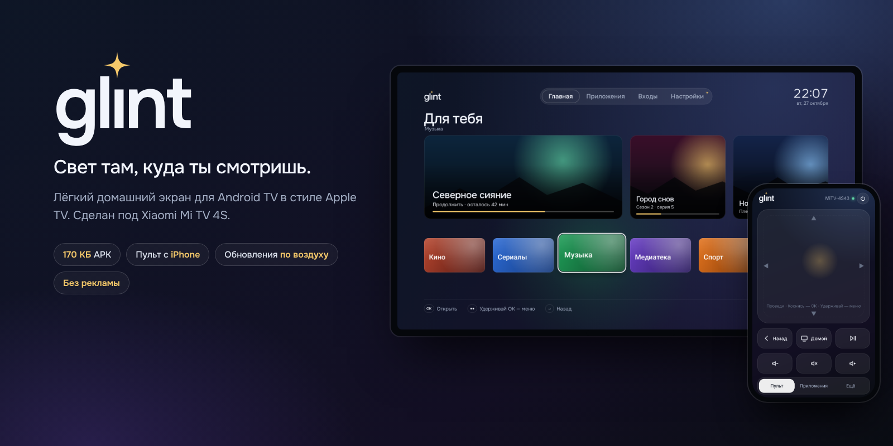
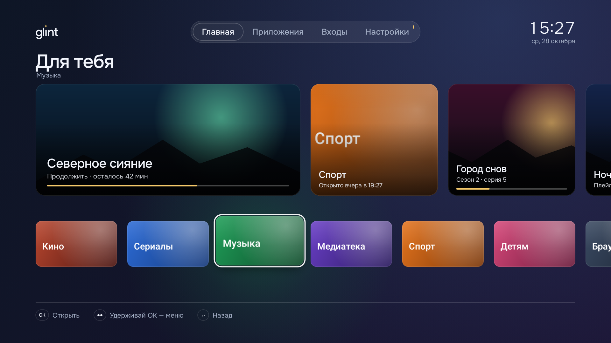
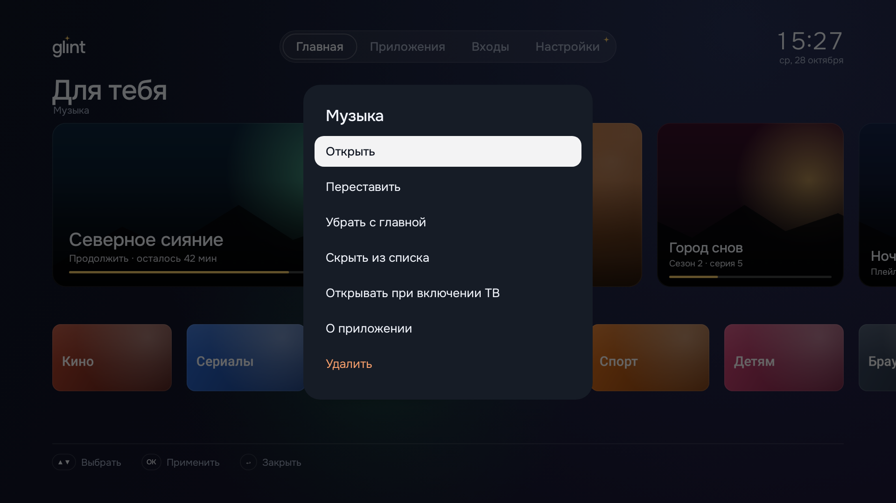
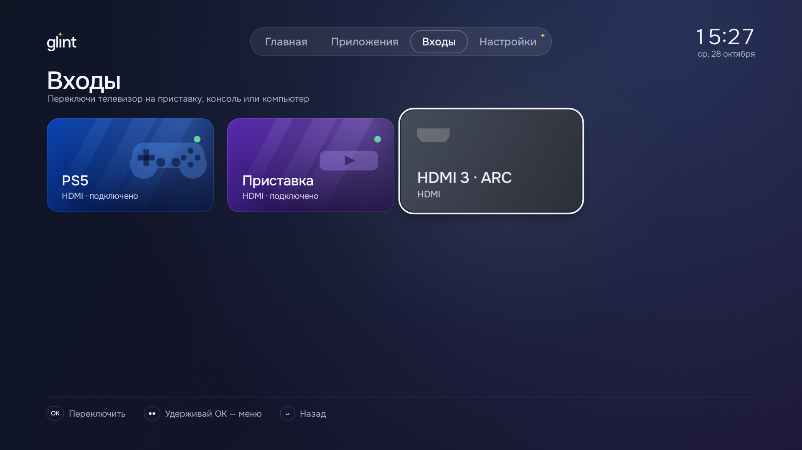
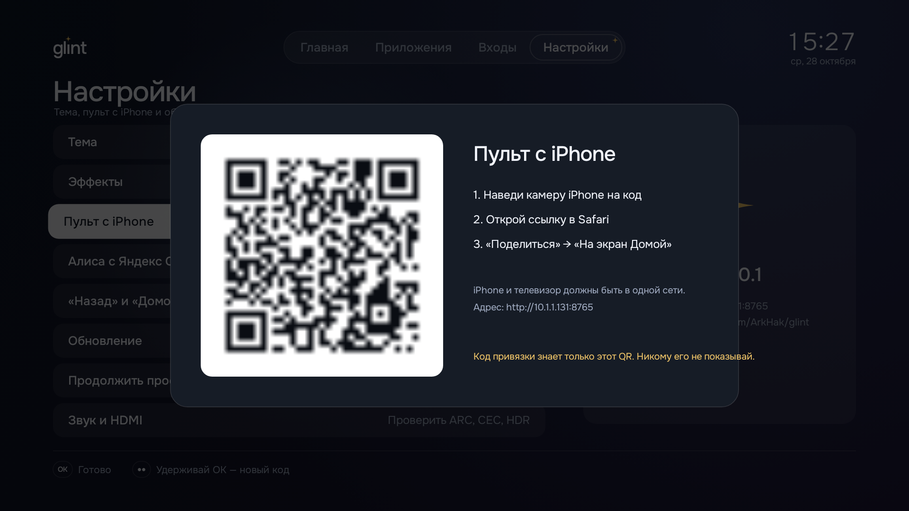

<p align="right"><a href="README.md">Русский</a> · <b>English</b></p>

<p align="center">
  
</p>

<h3 align="center">A home screen for Android TV: glass and light like Apple TV, the weight of a system utility.</h3>

<p align="center">
  <a href="https://github.com/ArkHak/glint/releases/latest/download/Glint.apk"></a>
</p>

Glint was built for the Xiaomi Mi TV 4S 43 and runs on any Android TV 8+.
There are no ads and no third-party services. It comes with an iPhone remote and updates itself over the air.
The interface is in Russian for now.

## Why Glint

- **No ads.** No "Sponsored" rows. The home screen shows only your things: Continue watching, favourites and HDMI inputs.
- **Apple TV-style focus.** The focused tile grows and lifts, tilts slightly and catches a glint of light. It runs at 60 fps on a modest Mali-470.
- **iPhone remote.** Touchpad, volume, pause, TV power-off, apps and inputs. Pair it with a QR code in 10 seconds.
- **HDMI inputs in one press.** Rename "HDMI 2" to "PS5". The console can start together with the TV.
- **Lightweight.** The APK is about 200 KB, cold start takes under 0.5 s and memory use is about 43 MB.
- **Updates and an honest rollback.** Each update is checked against its SHA-256 and signature before it installs.
  The stock launcher is only disabled, never removed, and comes back with one command.

## Screenshots

<table>
  <tr>
    <td width="50%"></td>
    <td width="50%"></td>
  </tr>
  <tr>
    <td></td>
    <td></td>
  </tr>
</table>

## Install

1. On the TV, install **Downloader** from Google Play, enter
   `github.com/ArkHak/glint/releases/latest/download/Glint.apk` and press Install.
2. Android TV 9 has no launcher picker, so disable the stock launcher over adb
   (your data is kept):
   ```bash
   adb shell pm disable-user --user 0 com.google.android.tvlauncher
   ```
3. Glint → Settings → iPhone remote → scan the QR code → Safari → Share → Add to Home Screen.

**Rollback:** `adb shell pm enable com.google.android.tvlauncher`, then press Home.
Don't uninstall Glint while the stock launcher is disabled.

Release notes are on the [releases page](https://github.com/ArkHak/glint/releases).

---

<sub>Glint is an independent project, not affiliated with Xiaomi or Google. Onest font (SIL OFL 1.1),
Nayuki QR Code generator (MIT).</sub>
