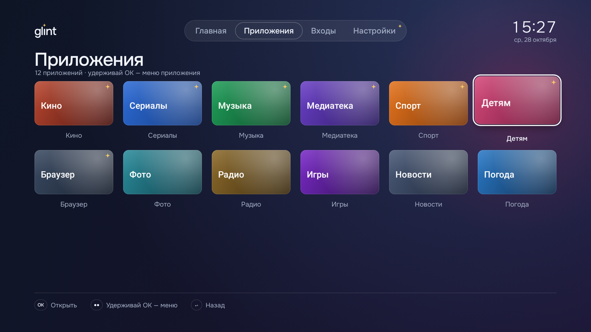
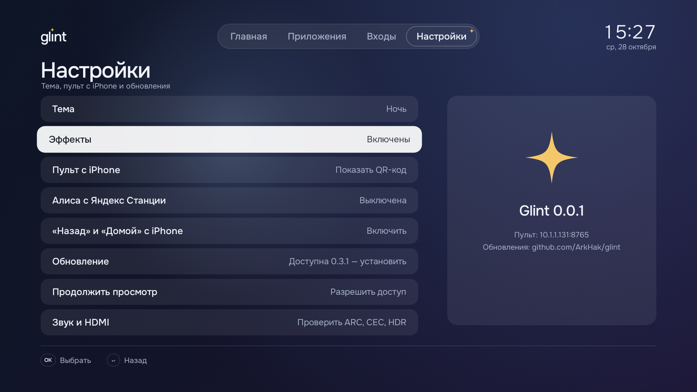
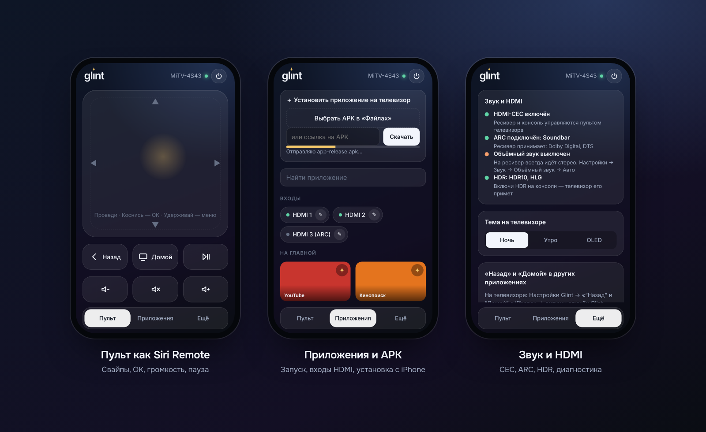

<p align="right"><b>Русский</b> · <a href="README.en.md">English</a></p>

<p align="center">
  
</p>

<h3 align="center">Домашний экран для Android TV: стекло и свет как у Apple TV, вес как у системной утилиты.</h3>

<p align="center">
  <a href="https://github.com/ArkHak/glint/releases/latest/download/Glint.apk"></a>
  &nbsp;
  <a href="#установка"></a>
</p>

<p align="center">
  
  
  
</p>

Glint сделан под Xiaomi Mi TV 4S 43 и работает на любом Android TV 8+.
В нём нет рекламы и чужих сервисов, есть пульт на iPhone, и он обновляется по воздуху.

## Почему Glint

<table>
  <tr>
    <td width="33%" valign="top">
      <b>Без рекламы</b><br>
      Нет рядов «Sponsored». На главной только твоё: «Продолжить просмотр», избранное, входы HDMI.
    </td>
    <td width="33%" valign="top">
      <b>Фокус как у Apple TV</b><br>
      Плитка увеличивается и поднимается, слегка наклоняется, по стеклу пробегает блик. 60 кадров на слабом Mali-470.
    </td>
    <td width="33%" valign="top">
      <b>Пульт на iPhone</b><br>
      Тачпад, громкость, пауза, выключение ТВ, запуск приложений и входов. Привязка по QR за 10 секунд.
    </td>
  </tr>
  <tr>
    <td valign="top">
      <b>Входы HDMI в одно нажатие</b><br>
      Переименуй «HDMI 2» в «PS5». Консоль может включаться сама вместе с телевизором.
    </td>
    <td valign="top">
      <b>Алиса</b><br>
      «Алиса, выключи телевизор», «сделай тише», «переключи вход на второй» — с Яндекс Станции.
    </td>
    <td valign="top">
      <b>Лёгкий</b><br>
      APK около 200 КБ, холодный старт меньше 0,5 с, около 43 МБ памяти.
    </td>
  </tr>
  <tr>
    <td colspan="3" valign="top">
      <b>Обновления по воздуху и честный откат</b><br>
      Glint сам предлагает новую версию и показывает, что в ней нового. Перед установкой проверяет SHA-256 и подпись.
      Стоковый лаунчер только выключается, а не удаляется, и возвращается одной командой.
    </td>
  </tr>
</table>

## Как выглядит

<table>
  <tr>
    <td width="50%"><br><sub><b>Главная.</b> «Продолжить просмотр», избранное, входы и ряды каналов.</sub></td>
    <td width="50%"><br><sub><b>Меню по удержанию OK.</b> Переставить, скрыть, открывать при включении, удалить.</sub></td>
  </tr>
  <tr>
    <td><br><sub><b>Все приложения</b>, включая Google Play.</sub></td>
    <td><br><sub><b>Настройки.</b> Тема, пульт, «Звук и HDMI», обновления.</sub></td>
  </tr>
  <tr>
    <td><br><sub><b>Входы HDMI</b> с именами и автозапуском.</sub></td>
    <td><br><sub><b>Пульт с iPhone</b> — привязка по QR.</sub></td>
  </tr>
</table>

<p align="center"></p>
<p align="center"><sub>Снимки экрана. Данные демонстрационные.</sub></p>

## Установка

Приложения, Google Play и аккаунты не затрагиваются: лаунчер только показывает иконки.

<table>
  <tr>
    <td width="33%" valign="top">
      <b>1. Поставьте Glint</b><br>
      На ТВ установите из Google Play <b>Downloader</b>, введите адрес
      <code>github.com/ArkHak/glint/releases/latest/download/Glint.apk</code> и нажмите «Установить».
    </td>
    <td width="33%" valign="top">
      <b>2. Сделайте главным</b><br>
      На Android TV 9 нет выбора лаунчера: выключите стоковый одной командой adb (ниже). Если система спросит, какой экран открывать по Home, выберите Glint.
    </td>
    <td width="33%" valign="top">
      <b>3. Привяжите iPhone</b><br>
      Glint → Настройки → «Пульт с iPhone» → QR → Safari → «Поделиться» → «На экран Домой».
    </td>
  </tr>
</table>

Дальше Glint обновляется сам: Настройки → «Обновление».

<details>
<summary><b>Команды adb — подробно</b></summary>

Включите на ТВ отладку: Настройки → Настройки устройства → Об устройстве → 7 раз нажмите «Сборка».
Затем «Для разработчиков» → «Отладка по USB». IP телевизора — в настройках сети.
На компьютере нужен [adb](https://developer.android.com/tools/releases/platform-tools)
(`brew install android-platform-tools` на Mac, `winget install Google.PlatformTools` на Windows).

```bash
adb connect 192.168.1.50                      # на ТВ: «Разрешить отладку?» → Всегда → OK
adb install -r Glint.apk                      # если ставите с компьютера

# Сделать Glint домашним экраном: выключить стоковый лаунчер (данные сохраняются)
adb shell pm disable-user --user 0 com.google.android.tvlauncher

# Собрать главную из частых приложений
adb shell appops set tv.glint.home GET_USAGE_STATS allow

# «Назад», «Домой» и выключение ТВ с iPhone — служба спецвозможностей Glint
adb shell settings put secure enabled_accessibility_services tv.glint.home/tv.glint.home.remote.GlintAccessibilityService
adb shell settings put secure accessibility_enabled 1
```

Если у вас уже включены другие службы спецвозможностей, допишите Glint к ним через `:`, а не заменяйте.
</details>

<details>
<summary><b>Откат на стоковый лаунчер</b></summary>

```bash
adb shell pm enable com.google.android.tvlauncher
```

Нажмите Home — вернётся стоковый лаунчер со всеми рядами и настройками.
**Не удаляйте Glint, пока стоковый лаунчер выключен**, иначе у телевизора не будет домашнего экрана.
Настройки Glint можно сохранить заранее: пульт на iPhone → «Ещё» → «Резервная копия Glint».
</details>

## Что нового

Описание каждой версии — на [странице релизов](https://github.com/ArkHak/glint/releases).
На телевизоре то же самое показывается перед установкой обновления.

## Вопросы

<details>
<summary><b>Что-то не работает</b></summary>

Пульт на iPhone → «Ещё» → «Диагностика» → «Скопировать отчёт». Вставьте отчёт в
[issue «Что-то не работает»](https://github.com/ArkHak/glint/issues/new?template=bug.yml).
В нём версия, модель, память, плавность и последний сбой, личных данных там нет.
</details>

<details>
<summary><b>Почему на Android 9 стрелки с iPhone работают только в Glint</b></summary>

Android 9 не даёт стороннему приложению нажимать стрелки в чужих приложениях. В них с iPhone работают
«Назад», «Домой», громкость, пауза и запуск. Полное управление в любых приложениях — в планах.
</details>

<details>
<summary><b>Безопасно ли это</b></summary>

Пульт закрыт токеном из QR-кода, подбор блокируется. Обновления приходят только отсюда и только с той же подписью.
Glint не открывает HDMI-сеансы и не держит звук, поэтому ARC и саундбар работают как раньше.
</details>

---

<sub>Glint — независимый проект, не связан с Xiaomi и Google. Шрифт Onest (SIL OFL 1.1), генератор QR-кодов
Nayuki QR Code generator (MIT).</sub>
